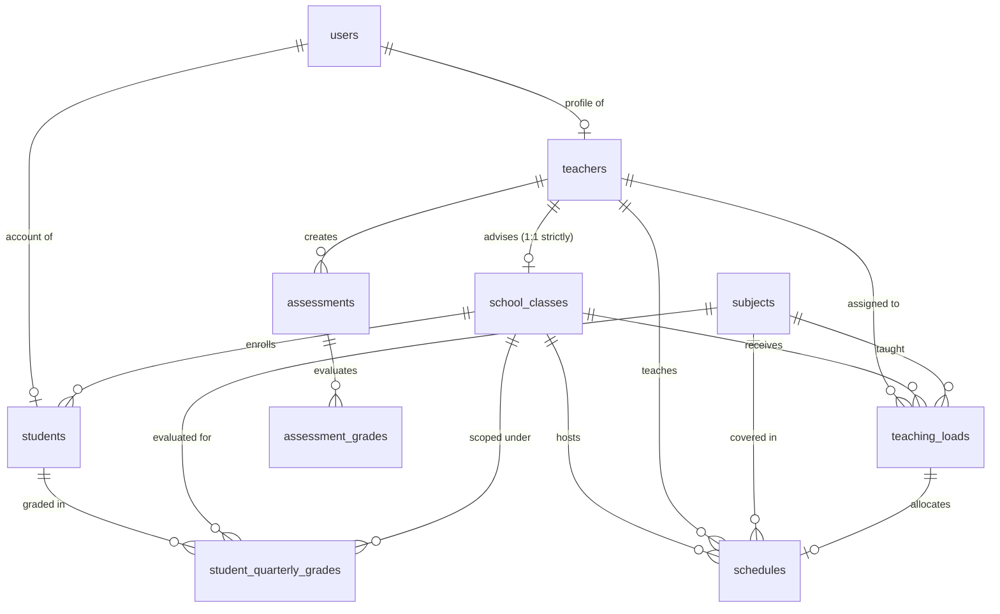
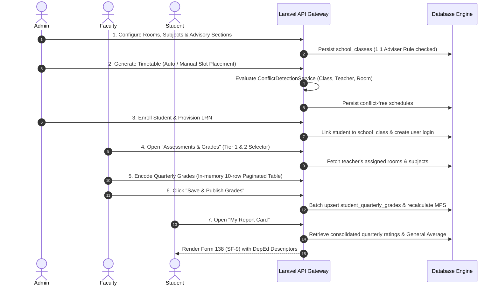

# Ayala National High School — Automated Scheduling & Academic Operations Suite
## System Architecture, Functionalities, and Domain Logic Manual

---

### Executive Overview

The **Ayala National High School Automated Scheduling & Academic Operations Suite** is an enterprise-grade institutional platform engineered specifically to solve the complex operational challenges of Philippine secondary education under the **Department of Education (DepEd) K-12 Basic Education Program**.

The system unifies:
1. **Automated Timetable Scheduling & Triple-Vector Conflict Detection**
2. **Classroom Directory & Section Management (Strict DepEd 1:1 Advisory Constraint)**
3. **Faculty Workload Balancing & Single Grade-Level Policy Enforcement**
4. **Student Provisioning & Master Enrollment Directory (LRN-indexed)**
5. **Interactive DepEd SF-9 (Form 138) Quarterly Gradebook & E-Class Record Engine**
6. **Role-Based Access Control (Admin, Faculty/Teacher, Learner/Student Portals)**

---

## 1. High-Level System Architecture

The suite adopts a modernized, decoupled **API-First Multi-Tier Architecture**:

```mermaid
graph TD
    subgraph Client Tier [Frontend Application Tier - React 18 + Vite]
        Landing[Public Portal & LRN Lookup]
        AdminApp[Admin Operations Suite]
        TeacherApp[Teacher & Faculty Portal]
        StudentApp[Student & Parent Portal]
    end

    subgraph API Gateway [Routing & Security Middleware]
        RouteGuard[Laravel API Router]
        AuthSanctum[Session & Token Authentication]
        RBAC[Role-Based Access Control: admin | teacher | student]
    end

    subgraph Domain Services [Laravel 11 Application Tier]
        ConflictService[ConflictDetectionService]
        WorkloadService[WorkloadMonitoringService]
        TeachingLoadService[TeachingLoadService]
        QuarterlyGradeController[QuarterlyGrade Engine & MPS]
        NotificationService[GmailNotificationService]
    end

    subgraph Persistence [Database Tier - MySQL / MariaDB]
        DB_Users[(users)]
        DB_Teachers[(teachers)]
        DB_Classes[(school_classes)]
        DB_Subjects[(subjects)]
        DB_Schedules[(schedules)]
        DB_Loads[(teaching_loads)]
        DB_Students[(students)]
        DB_Grades[(student_quarterly_grades)]
        DB_Assessments[(assessments)]
    end

    Client Tier --> API Gateway
    API Gateway --> Domain Services
    Domain Services --> Persistence
```

### Technology Stack
* **Backend Framework**: PHP 8.3+ with Laravel 11.x
* **Frontend Library**: React 18.x with Vite 6.x
* **Styling & Design System**: Tailwind CSS with custom Elevated Academic Theme tokens
* **Icons & Visuals**: Lucide React Icons
* **Database**: MySQL 8.0+ / MariaDB 10.6+
* **Authentication**: State-aware Session & RBAC Middleware (`role:admin`, `role:teacher`, `role:student`)

---

## 2. Database Schema & Entity Relationship Model



### Core Schema Definitions

#### 1. `users`
* `id` (PK): Unique user ID.
* `name`: Full legal name.
* `email`: Official email address (must be unique).
* `password`: Hashed bcrypt credentials.
* `role`: Enum `admin`, `teacher`, `student`.
* `account_status`: Enum `active`, `suspended`, `pending`.

#### 2. `teachers`
* `id` (PK): Unique faculty identifier.
* `user_id` (FK $\rightarrow$ `users.id`): Associated account.
* `employee_id`: Institutional DepEd ID (e.g., `ANHS-T-2026-001`).
* `position`: Faculty rank (Teacher I, II, III, Master Teacher I, II, Head Teacher).
* `specialization`: Primary field of expertise (e.g., Mathematics, Science, English).
* `departments`: JSON array of departmental stages (`["JHS"]` or `["SHS"]`).
* `assigned_grade_level`: Integer (7 to 12). Locks faculty to their designated grade level for the academic year.
* `qualified_subject_ids`: JSON array of eligible curriculum subject IDs.
* `permissions`: JSON key-value pairs (`is_adviser_eligible`, `can_encode_grades`, etc.).
* `max_weekly_hours`: Weekly cap (default: `30` hours).
* `max_classes_per_day`: Daily cap (default: `9` periods).

#### 3. `school_classes`
* `id` (PK): Classroom section identifier.
* `name`: Section Display Name (e.g., `Grade 7 - Gold`, `Grade 11 - STEM A`).
* `grade_level`: Integer 7 to 12.
* `track`: `Junior High School`, `Academic Track (SHS)`, `TVL Track (SHS)`.
* `strand`: `JHS General`, `STEM`, `ABM`, `HUMSS`, `TVL-ICT`, etc.
* `section`: Section token (e.g., `Gold`, `Diamond`, `Emerald`).
* `adviser_id` (FK $\rightarrow$ `teachers.id`, nullable): Designated Class Adviser.
* `room`: Physical classroom / building venue (e.g., `Building J`, `Room 101`).
* `max_capacity`: Maximum learner limit (default: `45` to `70`).
* `shift`: `Whole Day Shift`, `Morning Shift`, `Afternoon Shift`.

#### 4. `schedules`
* `id` (PK): Unique timetable slot.
* `teaching_load_id` (FK, nullable): Parent curriculum teaching load.
* `teacher_id` (FK $\rightarrow$ `teachers.id`): Assigned instructor.
* `subject_id` (FK $\rightarrow$ `subjects.id`): Subject taught.
* `school_class_id` (FK $\rightarrow$ `school_classes.id`): Target section.
* `day_of_week`: `Monday`, `Tuesday`, `Wednesday`, `Thursday`, `Friday`, `Saturday`.
* `start_time`: Time string `HH:MM:SS`.
* `end_time`: Time string `HH:MM:SS`.
* `room`: Assigned physical classroom or specialized lab venue.
* `session_type`: `lecture`, `laboratory`, `remedial`, `advisory_period`.

#### 5. `students`
* `id` (PK): Internal student record ID.
* `user_id` (FK $\rightarrow$ `users.id`): Account credentials.
* `lrn`: DepEd 12-digit Learner Reference Number (unique, indexed).
* `name`: Student full legal name.
* `school_class_id` (FK $\rightarrow$ `school_classes.id`): Assigned classroom section.
* `grade_level`: 7 to 12.
* `gender`: `Male`, `Female`.
* `status`: `enrolled`, `transferred`, `dropped`.

#### 6. `student_quarterly_grades`
* `id` (PK): Grade record.
* `student_id` (FK $\rightarrow$ `students.id`): Graded student.
* `school_class_id` (FK $\rightarrow$ `school_classes.id`): Scoped section.
* `subject_id` (FK $\rightarrow$ `subjects.id`): Graded subject.
* `academic_year`: Default `2026-2027`.
* `q1`, `q2`, `q3`, `q4`: Decimal quarterly ratings (0.00 to 100.00).
* `final_rating`: Calculated annual or semestral final grade.
* `remarks`: `PASSED`, `FAILED`, `AT-RISK`.
* `is_locked`: Boolean indicating if registrar or faculty has locked the quarter.

---

## 3. Core Business Rules & DepEd Policy Constraints

### A. The Strict 1:1 Class Advisory Constraint
* **DepEd Regulation**: A teacher can serve as the **Class Adviser** for **at most one section** in any active school year.
* **Backend Guard ([`SchoolClassController.php`](file:///home/quinto_ge/MY%20PROJECTS/Ayala-National%20Highschool/AYALA-AUTOMATED-SCHEDULING/app/Http/Controllers/Api/SchoolClassController.php#L50-L59))**:
  When creating or updating a section with an `adviser_id`, the system queries if that teacher already advises another section. If found, the request is rejected with **HTTP 422**:
  > *"This teacher is already assigned as Class Adviser to [Class Name]. Under DepEd regulations, a teacher can advise at most one class section."*
* **Frontend Guard ([`ClassroomFormModal.jsx`](file:///home/quinto_ge/MY%20PROJECTS/Ayala-National%20Highschool/AYALA-AUTOMATED-SCHEDULING/resources/js/components/schedules/ClassroomFormModal.jsx))**:
  The adviser dropdown labels occupied teachers as `[OCCUPIED] Adviser of [Section Name]` and disables selection.
* **TBA Policy**: Classrooms can freely be created and operated with `TBA (Unassigned)` advisers.

### B. Single Grade-Level Faculty Lock (Grades 7–12)
* **DepEd Faculty Assignment Policy**: To maintain curriculum mastery, a teacher assigned to a grade level (e.g., Grade 7) is **strictly locked to teaching only Grade 7 subjects and sections** for that entire academic year.
* **Backend Guard ([`Teacher.php`](file:///home/quinto_ge/MY%20PROJECTS/Ayala-National%20Highschool/AYALA-AUTOMATED-SCHEDULING/app/Models/Teacher.php#L72-L85) & Controllers)**:
  `isAuthorizedForGrade($gradeLevel)` checks whether `$teacher->assigned_grade_level == $gradeLevel`. Both `ScheduleController` and `TeachingLoadController` block assignments across mismatched grade levels with **HTTP 422**.
* **Reassignment**: Faculty grade levels can only be reassigned upon academic year transitions.

### C. Faculty Workload Limits & Caps
* **Weekly Hours Cap**: Maximum of **30 hours per week** of teaching loads.
* **Daily Periods Cap**: Maximum of **9 class periods per day**.
* **Workload Status Calculation ([`WorkloadMonitoringService.php`](file:///home/quinto_ge/MY%20PROJECTS/Ayala-National%20Highschool/AYALA-AUTOMATED-SCHEDULING/app/Services/WorkloadMonitoringService.php))**:
  * $\text{Hours} < 20$: **Underload**
  * $20 \le \text{Hours} \le 30$: **Normal Load**
  * $\text{Hours} > 30$: **Overload (Alert Flagged)**

### D. Triple-Vector Conflict Detection Engine ([`ConflictDetectionService.php`](file:///home/quinto_ge/MY%20PROJECTS/Ayala-National%20Highschool/AYALA-AUTOMATED-SCHEDULING/app/Services/ConflictDetectionService.php))
Before any timetable slot is saved or moved, the conflict engine evaluates three orthogonal vectors:

$$\text{Time Overlap Formula: } (\text{existing.start} < \text{proposed.end}) \land (\text{existing.end} > \text{proposed.start})$$

1. **Classroom Section Conflict**: A section cannot have two overlapping subject classes on the same day.
2. **Teacher Conflict**: A teacher cannot teach two different sections or venues at the same time.
3. **Room/Venue Conflict**: A physical classroom or laboratory cannot host two different sessions simultaneously.

If any overlap is detected, the operation is blocked and detailed metadata (conflicting subject, instructor, and time) is returned to the user.

### E. DepEd Grading Logic & Descriptor Mapping ([DepEd Order No. 8, s. 2015](file:///home/quinto_ge/MY%20PROJECTS/Ayala-National%20Highschool/AYALA-AUTOMATED-SCHEDULING/app/Http/Controllers/Api/QuarterlyGradeController.php#L510-L545))

#### Junior High School (Grades 7–10)
$$\text{Final Rating} = \text{round}\left(\frac{Q_1 + Q_2 + Q_3 + Q_4}{4}\right)$$

#### Senior High School (Grades 11–12 Semestral Model)
$$\text{Sem 1 Final} = \text{round}\left(\frac{Q_1 + Q_2}{2}\right), \quad \text{Sem 2 Final} = \text{round}\left(\frac{Q_3 + Q_4}{2}\right)$$

#### Official DepEd Descriptor Scale:
| Grade Range | Descriptor Label | Status | Indicator Badge |
| :--- | :--- | :--- | :--- |
| **90.00 – 100.00** | **Outstanding** | PASSED | Emerald Badge |
| **85.00 – 89.99** | **Very Satisfactory** | PASSED | Blue Badge |
| **80.00 – 84.99** | **Satisfactory** | PASSED | Cyan Badge |
| **75.00 – 79.99** | **Fairly Satisfactory** | PASSED | Amber Badge |
| **Below 75.00** | **Did Not Meet Expectations** | FAILED / AT-RISK | Rose Red Badge |

---

## 4. Subsystem Deep-Dives

### Subsystem 1: Timetable & Automated Scheduling Engine

#### Components
* [`ScheduleManagement.jsx`](file:///home/quinto_ge/MY%20PROJECTS/Ayala-National%20Highschool/AYALA-AUTOMATED-SCHEDULING/resources/js/pages/admin/ScheduleManagement.jsx): Admin master dashboard for weekly timetables.
* [`DynamicKanbanTimetable.jsx`](file:///home/quinto_ge/MY%20PROJECTS/Ayala-National%20Highschool/AYALA-AUTOMATED-SCHEDULING/resources/js/components/schedules/DynamicKanbanTimetable.jsx): Day-by-day interactive timetable grid.
* [`InteractiveScheduleModal.jsx`](file:///home/quinto_ge/MY%20PROJECTS/Ayala-National%20Highschool/AYALA-AUTOMATED-SCHEDULING/resources/js/components/schedules/InteractiveScheduleModal.jsx): Slot creator with instant conflict pre-check and grade-lock validation.

#### Functionality
1. **Interactive Day Matrix**: Visualizes Monday through Friday class periods (7:30 AM to 5:00 PM).
2. **Automated Batch Scheduling**: Distributes weekly curriculum hours across sections using available rooms and unassigned faculty without creating conflicts.
3. **Filterable Views**: Timetable can be pivoted by **Class Section**, **Faculty Member**, or **Room Venue**.

---

### Subsystem 2: Classroom Sections & Advisory Directory

#### Components
* [`StudentProvisioningPage.jsx`](file:///home/quinto_ge/MY%20PROJECTS/Ayala-National%20Highschool/AYALA-AUTOMATED-SCHEDULING/resources/js/pages/admin/StudentProvisioningPage.jsx): Admin directory for sections and enrolled students.
* [`ClassroomDirectory.jsx`](file:///home/quinto_ge/MY%20PROJECTS/Ayala-National%20Highschool/AYALA-AUTOMATED-SCHEDULING/resources/js/components/schedules/ClassroomDirectory.jsx): Directory view with responsive 3-column card grid.
* [`ClassroomFormModal.jsx`](file:///home/quinto_ge/MY%20PROJECTS/Ayala-National%20Highschool/AYALA-AUTOMATED-SCHEDULING/resources/js/components/schedules/ClassroomFormModal.jsx): Section creation and configuration modal.

#### Functionality
1. **Responsive 3-Column Directory Grid**: Full-width cards displaying capacity, room venue, adviser, enrolled count, and shift.
2. **Adviser Integrity**: Prevents assigning an occupied teacher to multiple sections.
3. **Student Enrollee Roster**: Master list per classroom with LRN verification, enrollment tracking, and student account provisioning.

---

### Subsystem 3: Interactive Gradebook & E-Class Record Engine

#### Components
* [`InteractiveQuarterlyGradebook.jsx`](file:///home/quinto_ge/MY%20PROJECTS/Ayala-National%20Highschool/AYALA-AUTOMATED-SCHEDULING/resources/js/components/grades/InteractiveQuarterlyGradebook.jsx): High-density grading studio.
* [`QuarterlyGradeController.php`](file:///home/quinto_ge/MY%20PROJECTS/Ayala-National%20Highschool/AYALA-AUTOMATED-SCHEDULING/app/Http/Controllers/Api/QuarterlyGradeController.php): Backend matrix computation and batch save.

#### Scalable 2-Tier Architecture
To prevent visual clutter when a teacher handles up to 9 different classrooms:

```
[ Tier 1: Scalable Room Command Bar ]
  [ < Prev Room ]  [ 🏫 Active Room: Grade 7 - Gold (Bldg J) ▾ ]  [ Next Room > ]  [ View: Studio | All Rooms ]
                          │
                          ▼ (When clicked: Searchable Drawer with Advisory pinned first)

[ Tier 2: Subject Selector Tabs for Active Room ]
  Subjects in Grade 7 - Gold:   [ 📘 Mathematics 7 (MATH7) ]   [ 📗 ESP 7 (ESP7) ]   [ 📙 AP 7 (AP7) ]

[ Modular Gradebook Table ]
  Modular Toolbar: [ Designation Dropdown ▾ ]  [ Sort Dropdown ▾ ]  [ Search LRN... ]  [ Save & Publish ]
  Grouped Headers: [ Module 1: Identification ] [ Module 2: Quarterly Ratings ] [ Module 3: Final Outcome ]
  Strict Pagination: 10 students per page (maintains dirty state across pages)
  Aggregate MPS Footer: Displays Section Mean for Q1, Q2, Q3, Q4, and Overall Final Rating.
```

---

### Subsystem 4: Portals & Role-Based Access Control

#### 1. Administrator Operations Suite (`role:admin`)
* Full CRUD on Faculty, Classrooms, Subjects, Timetables, and Student accounts.
* Conflict Center for audit logs and schedule dispute resolution.
* Workload monitoring and official DepEd compliance reporting.

#### 2. Faculty / Teacher Portal (`role:teacher`)
* **My Teaching Loads**: Lists active schedules, room assignments, and meeting times.
* **Assessments & E-Class Record**: Grade encoding for assigned subjects with real-time Mean, Passing Rate, and Watchlist metrics.
* **Advisory Privileges**: If designated as Class Adviser, the teacher can view consolidated grades across all subjects for their section.

#### 3. Student & Parent Portal (`role:student`)
* **My Class Timetable**: Live view of weekly schedule, room venues, and subject teachers.
* **Official DepEd SF-9 (Form 138) Card**: Consolidated quarterly ratings, general average, and promotion descriptor.
* **Classmates & Venue Directory**: Assigned room location and adviser information.

---

## 5. End-to-End Operational Lifecycle



---

## 6. Directory Map of Critical Source Files

```
AYALA-AUTOMATED-SCHEDULING/
├── app/
│   ├── Http/Controllers/Api/
│   │   ├── AuthController.php              # Session management & user roles
│   │   ├── ScheduleController.php          # Timetable management & auto-generation
│   │   ├── SchoolClassController.php       # Classrooms & 1:1 adviser validation
│   │   ├── TeacherController.php           # Faculty roster & grade level assignment
│   │   ├── StudentProvisioningController.php# Student enrollment & LRN management
│   │   ├── QuarterlyGradeController.php    # E-Class Record & SF-9 grade calculations
│   │   ├── StudentPortalController.php     # Student timetable & report card endpoints
│   │   └── TeacherPortalController.php     # Faculty workload & schedule queries
│   ├── Models/
│   │   ├── Teacher.php                     # Grade-level authorization & load rules
│   │   ├── SchoolClass.php                 # Classroom entity & advisory relations
│   │   ├── Schedule.php                    # Timetable session model
│   │   ├── Student.php                     # Learner reference entity
│   │   └── StudentQuarterlyGrade.php       # Quarterly grade repository
│   └── Services/
│       ├── ConflictDetectionService.php    # Triple-vector collision engine
│       ├── WorkloadMonitoringService.php   # 30-hour weekly cap & overload monitor
│       └── GmailNotificationService.php    # Automated faculty notification emails
│
├── database/seeders/
│   └── AyalaDatabaseSeeder.php             # DepEd K-12 catalog (Grades 7–12)
│
└── resources/js/
    ├── api/endpoints.js                    # Centralized Axios API client
    ├── components/
    │   ├── grades/
    │   │   └── InteractiveQuarterlyGradebook.jsx # Modular 2-Tier Gradebook
    │   ├── schedules/
    │   │   ├── DynamicKanbanTimetable.jsx  # Day-by-day timetable grid
    │   │   ├── InteractiveScheduleModal.jsx# Schedule editor & conflict tester
    │   │   └── ClassroomFormModal.jsx      # Section modal with [OCCUPIED] adviser badge
    │   └── ui/
    │       └── Pagination.jsx              # Universal 10-item data paginator
    └── pages/
        ├── admin/
        │   ├── ScheduleManagement.jsx      # Master timetable administrator suite
        │   ├── StudentProvisioningPage.jsx # Section cards & student masterlist
        │   └── TeacherManagement.jsx       # Faculty profiles & workload dashboard
        ├── teacher/
        │   └── TeacherPortal.jsx           # Faculty portal & gradebook studio
        └── student/
            └── StudentPortal.jsx           # Student schedule & SF-9 report card
```

---

*Document compiled and verified for Ayala National High School Academic Suite.*

